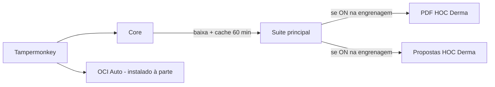

# Feegow Enhanced Suite

<div align="center">


</div>

Conjunto de **userscripts** (Tampermonkey) que acrescentam recursos ao sistema de gestão clínica **Feegow**, sem alterar o sistema original. Foram escritos para a rotina do HOC (oftalmologia e HOC Derma), mas qualquer usuário do Feegow consegue instalar.

Tudo roda **no seu navegador**. Os scripts mudam só o que você vê na tela: nenhum deles grava dados no Feegow.

---

## Índice

- [Os scripts](#os-scripts)
- [Instalação](#instalação)
- [Atualização automática](#atualização-automática)
- [O que cada script faz](#o-que-cada-script-faz)
  - [Core (injetor)](#core-injetor)
  - [Suite principal](#suite-principal)
  - [PDF HOC Derma (Timbrador)](#pdf-hoc-derma-timbrador)
  - [Propostas HOC Derma](#propostas-hoc-derma)
  - [OCI Auto](#oci-auto)
- [Privacidade e segurança](#privacidade-e-segurança)
- [Solução de problemas](#solução-de-problemas)
- [Para desenvolvedores](#para-desenvolvedores)
- [Histórico resumido](#histórico-resumido)
- [Licença](#licença)

---

## Os scripts

| Script | Para que serve | Versão | Instalar |
| :--- | :--- | :---: | :--- |
| **Core** (`core.user.js`) | Injetor: baixa a Suite do GitHub, guarda em cache e executa. É o único que você precisa instalar para ter a Suite, o Timbrador e as Propostas. | 1.1.1.0 | [instalar](https://raw.githubusercontent.com/Nicker2/Feegow-Enhanced-Suite/main/core.user.js) |
| **Suite principal** (`VERIFICAR-DR-EXAMES.user.js`) | Lista de espera com contador do DR. EXAMES, menu de engrenagem, limpeza da interface, login com sessão dupla, especialidade e protocolo de dilatação, atalho para o prontuário. | 4.9.5.1 | carregada pelo Core ([avulsa](https://raw.githubusercontent.com/Nicker2/Feegow-Enhanced-Suite/main/VERIFICAR-DR-EXAMES.user.js)) |
| **PDF HOC Derma** (`hoc-derma-stamping-tool.user.js`) | Janela que aplica o cabeçalho e o rodapé HOC Derma em qualquer PDF, ajusta o encaixe e exporta/imprime o PDF timbrado. | 3.1.0 | carregado pela Suite ([avulso](https://raw.githubusercontent.com/Nicker2/Feegow-Enhanced-Suite/main/hoc-derma-stamping-tool.user.js)) |
| **Propostas HOC Derma** (`hoc-derma-propostas.user.js`) | Botão **Imprimir HOC Derma** na proposta do prontuário: editor de valores e folha A4 com o timbrado HOC Derma. | 1.3.x | carregado pela Suite ([avulso](https://raw.githubusercontent.com/Nicker2/Feegow-Enhanced-Suite/main/hoc-derma-propostas.user.js)) |
| **OCI Auto** (`oci-auto-tool.user.js`) | Preenche a ficha OCI/APAC em PDF com os dados do prontuário, com a assinatura do médico, e imprime ou baixa. | 1.0.0 | [instalar](https://raw.githubusercontent.com/Nicker2/Feegow-Enhanced-Suite/main/oci-auto-tool.user.js) (sempre à parte) |

A versão vigente de cada script é a do `@version` no respectivo `.meta.js`. Documentação detalhada:

- [docs/core-e-cascata.md](docs/core-e-cascata.md): como o Core e a Suite baixam os outros scripts, cache e chaves salvas.
- [docs/suite-principal.md](docs/suite-principal.md): todas as funções da Suite e o menu de engrenagem.
- [docs/pdf-hoc-derma-timbrador.md](docs/pdf-hoc-derma-timbrador.md): guia completo do Timbrador.
- [docs/hoc-derma-propostas.md](docs/hoc-derma-propostas.md): guia completo das Propostas HOC Derma.
- [docs/oci-auto.md](docs/oci-auto.md): guia completo do OCI Auto.



---

## Instalação

**Pré-requisito:** navegador **Google Chrome** (ou Edge) com a extensão **Tampermonkey**.
[Chrome Web Store](https://chrome.google.com/webstore/detail/tampermonkey/dhdgffkkebhmkfjojejmpbldmpobfkfo) | [Edge](https://microsoftedge.microsoft.com/addons/detail/tampermonkey/dhdgffkkebhmkfjojejmpbldmpobfkfo) | [Firefox](https://addons.mozilla.org/pt-BR/firefox/addon/tampermonkey/)

> No Chrome recente, a extensão pode exigir o **Modo do desenvolvedor** ligado em `chrome://extensions` (ou a opção "Permitir scripts do usuário" nos detalhes da extensão) para executar userscripts.

### Recomendado: só o Core

1. Clique no link **instalar** do Core na [tabela](#os-scripts). O Tampermonkey abre a tela de instalação; confirme em **Instalar**.
2. Abra o Feegow (`app.feegow.com`) e recarregue a página. O Core baixa a Suite, e a Suite baixa o Timbrador e as Propostas.
3. A engrenagem aparece na barra superior do Feegow. Pronto.

### OCI Auto (opcional)

Clique em **instalar** do OCI Auto na tabela e confirme. Ele não entra na cascata, então é instalado à parte, com ou sem o Core.

### Instalação avulsa (sem o Core)

Cada script também funciona sozinho: abra o link *avulso* da tabela e confirme no Tampermonkey. Use isso para testar um script isolado.

> **Não instale a Suite avulsa junto com o Core**: ela rodaria duas vezes. Também evite instalar o Timbrador ou as Propostas avulsos com o Core ativo e o item ON na engrenagem: os scripts evitam botões duplicados, mas o código carregaria duas vezes.

---

## Atualização automática

Há dois mecanismos, e eles se complementam:

| Mecanismo | Vale para | Como funciona |
| :--- | :--- | :--- |
| **`@updateURL` do Tampermonkey** | Scripts instalados diretamente (Core, OCI Auto, ou qualquer avulso) | O Tampermonkey consulta o `.meta.js` no GitHub periodicamente. Se o `@version` for maior, baixa o `.user.js` novo. Para forçar: Painel do Tampermonkey → selecione o script → **Verificar atualizações** (ou, no menu da extensão, *Verificar atualizações de scripts do usuário*). |
| **Cascata com cache de 60 min** | Suite, Timbrador e Propostas carregados pelo Core | A cada carregamento do Feegow, se o código salvo tiver mais de 60 minutos, ele é baixado de novo de `raw.githubusercontent.com`. Uma versão publicada chega a todos os computadores em até cerca de 1 hora, sem ninguém fazer nada. |

Detalhes, chaves de cache e como forçar o download na hora: [docs/core-e-cascata.md](docs/core-e-cascata.md).

---

## O que cada script faz

### Core (injetor)

`core.user.js` não tem interface. Em cada página do Feegow (`https://*.feegow.com/...`) ele:

1. verifica se a cópia da Suite guardada no armazenamento do Tampermonkey tem menos de 60 minutos; se tiver, executa direto (instantâneo);
2. se venceu (ou é a primeira vez), baixa a Suite do GitHub. Só aceita a resposta se vier com HTTP 200 e cabeçalho de userscript, executa e só então guarda no cache;
3. sem rede, com o GitHub fora ou se a versão nova falhar ao iniciar, executa a cópia guardada, mesmo vencida.

Por isso a Suite continua funcionando sem internet, exceto na primeiríssima execução.

### Suite principal

`VERIFICAR-DR-EXAMES.user.js` (nome histórico; o nome exibido no Tampermonkey é "Suite Feegow Enhanced"). Funções:

- **Engrenagem de configurações** na barra superior, em qualquer tela: liga e desliga cada função por computador (tabela abaixo).
- **Lista de Espera**: a cada 10 s compara a fila geral com a do DR. EXAMES e mostra, ao lado de "pacientes aguardando", um **contador colorido** dos pacientes que estão **só** na fila do DR. EXAMES, com a lista deles (nome com link para o prontuário e selo "Primeira vez"). Também mostra a **especialidade** ao lado do nome do médico, o selo laranja **Dilatar (clique aqui)** quando o protocolo de dilatação do médico se aplica à idade do paciente, e mantém a lista sempre com **30 itens por página**.
- **Agenda**: botão ao lado do paciente que abre o **prontuário em nova aba**.
- **Limpeza da interface**: remove avisos amarelos, notificações flutuantes, barra DP Spaces/Doctoralia, assistente de IA, anúncios Beamer e o pedido de notificações push.
- **Login com sessão dupla**: quando o Feegow diz *"Este usuário já está conectado em outra máquina"*, mostra uma tela de carregamento e repete o login em segundo plano até a sessão ser liberada.
- **Cascata**: baixa e executa o Timbrador e as Propostas, e coloca o botão vermelho **PDF HOC Derma** à esquerda da engrenagem e no painel **Arquivos do Paciente**.

| Item da engrenagem | Quando ON | Padrão |
| :--- | :--- | :---: |
| DR. EXAMES (Lista de Espera) | Contador e lista dos exclusivos do DR. EXAMES | ON |
| Avisos Amarelos | Remove os avisos `.alert-warning` | ON |
| Notificações Flutuantes | Remove as notificações `.ui-pnotify` | ON |
| Barra DP Spaces | Remove a barra DP Spaces / Doctoralia | ON |
| IA Feegow | Remove o assistente de IA | ON |
| Anúncios Feegow | Remove os anúncios do Beamer | ON |
| Pedir Notificações | Remove o pedido de permissão de notificação push | ON |
| PDF HOC Derma (v3) | Carrega o Timbrador e mostra o botão vermelho | ON |
| Imprimir HOC Derma (Propostas) | Carrega o módulo de Propostas | ON |

Cada clique alterna o item e **recarrega a página**. Guia completo: [docs/suite-principal.md](docs/suite-principal.md).

### PDF HOC Derma (Timbrador)

`hoc-derma-stamping-tool.user.js` abre uma janela flutuante dentro do Feegow que aplica o **cabeçalho e o rodapé HOC Derma** em qualquer PDF.

- **Abrir:** botão vermelho **PDF HOC Derma** (barra superior ou painel Arquivos do Paciente) ou `Ctrl + Shift + H`.
- **Carregar:** escolha o PDF ou arraste para a janela.
- **AUTO:** encaixa o conteúdo entre o cabeçalho e o rodapé automaticamente ao abrir cada PDF.
- **Ajuste manual:** arraste a folha, use as setas ou as alças TOPO/BASE; ajuste **por documento** ou **por página**.
- **Exportar PDF nativo:** baixa `<nome>_timbrado.pdf` com o texto selecionável. **Imprimir** usa esse mesmo PDF.

Os ajustes ficam salvos no navegador, por arquivo. Guia completo: [docs/pdf-hoc-derma-timbrador.md](docs/pdf-hoc-derma-timbrador.md).

### Propostas HOC Derma

`hoc-derma-propostas.user.js` adiciona o botão vermelho **Imprimir HOC Derma** ao lado do Imprimir padrão, na proposta aberta no prontuário. O botão abre um editor que lê a proposta da tela (paciente, profissional, itens, descontos, forma de pagamento, textos) e permite ajustar os valores **só para a impressão**, com prévia da folha A4 com o timbrado HOC Derma, sem a tabela padrão do Feegow. As **Observações Internas nunca são impressas**, e nada é gravado no Feegow.

Guia completo (editor, configurações, opções de impressão): [docs/hoc-derma-propostas.md](docs/hoc-derma-propostas.md).

### OCI Auto

`oci-auto-tool.user.js` funciona só na tela do prontuário (`?p=pacientes&i=<id>&pers=1`). A pílula **OCI Auto** no canto inferior direito abre um painel que:

1. lê os dados do paciente do prontuário;
2. mostra os **58 campos** da ficha OCI/APAC para conferir e corrigir;
3. deixa escolher a **assinatura** do médico (24 embutidas, opcional);
4. monta o PDF sobre o formulário OCI em branco e **imprime** ou **baixa** (`OCI_<PACIENTE>.pdf`).

O PDF sai exatamente com o que está no painel: confira antes de imprimir. Guia completo: [docs/oci-auto.md](docs/oci-auto.md).

---

## Privacidade e segurança

O que foi verificado no código de cada script:

| Script | Acessos de rede | Armazenamento local |
| :--- | :--- | :--- |
| Core | Só `GET` em `raw.githubusercontent.com` (o próprio código da Suite). Nenhum dado é enviado. | Código da Suite e horário do download, no armazenamento do Tampermonkey. |
| Suite | `GET` em `raw.githubusercontent.com` (código do Timbrador e das Propostas). Consulta a lista de espera no **próprio Feegow** (`app.feegow.com`), com a sessão já aberta. No login com sessão dupla, reenvia usuário e senha **só para o formulário de login do Feegow**. As imagens da tela de carregamento vêm dos servidores do Feegow. | Preferências da engrenagem e cache, no Tampermonkey. Usuário e senha digitados ficam no `sessionStorage` da aba (ver aviso abaixo). |
| PDF HOC Derma | Nenhum no uso normal: pdf.js e pdf-lib vão embutidos e o PDF é processado no navegador. Só se o navegador não suportar `DecompressionStream` (versões anteriores a 2020) ou bloquear workers `blob:`, baixa as mesmas bibliotecas de `cdnjs.cloudflare.com` / `unpkg.com`, sem cookies. | Ajustes por arquivo no `localStorage` do Feegow (`hocderma:v3:*`). |
| Propostas HOC Derma | Nenhum. Só lê a tela. | Preferências no Tampermonkey. |
| OCI Auto | Lê o prontuário da tela. Se o Feegow tiver um token de API no `localStorage`, consulta o cadastro do paciente na **API do próprio Feegow** (`api.feegow.com`). pdf-lib embutido; CDN só em navegador sem `DecompressionStream`. | Nenhum dado de paciente é salvo. |

Em resumo:

- **Nenhum script envia dados para servidores de terceiros.** Os únicos destinos fora do Feegow são o GitHub (download do código) e, raramente, um CDN público de bibliotecas (download de código, sem cookies).
- **Nenhum script lê `document.cookie`.** As consultas ao Feegow usam a sessão do navegador, como qualquer página do Feegow.
- **Nenhum script grava no Feegow.** Não há cadastro, edição ou exclusão de registros.
- **Aviso sobre o login com sessão dupla:** ao clicar em **Entrar**, a Suite copia usuário e senha para o `sessionStorage` da aba, em texto simples, para poder repetir o login. Os valores são apagados quando a repetição dá certo; num login normal, ficam até a aba ser fechada (o `sessionStorage` some com a aba e não é compartilhado com outros sites). Em computador compartilhado, feche a aba depois de sair do Feegow.
- O código da cascata é executado com `eval` a partir do GitHub. Quem tem acesso de escrita a este repositório controla o que roda no navegador de quem usa o Core: proteja a conta do GitHub.

---

## Solução de problemas

**A engrenagem ou o botão PDF HOC Derma não aparece**
- Confira se o Core está **ativo** no Tampermonkey e se a página é `https://<algo>.feegow.com/...` (o Core e a Suite não rodam em `feegow.com.br`).
- A engrenagem se ancora no Caixa, em Tarefas ou no sino da barra superior. Os botões da barra somem em janelas estreitas (classes `hidden-sm hidden-xs` do Feegow): aumente a janela.
- O Timbrador e as Propostas precisam estar **ON** na engrenagem.
- O contador DR. EXAMES só aparece na Lista de Espera; o OCI Auto, só no prontuário.

**Publiquei uma versão e ela não chegou**
- Pela cascata, espere até 60 minutos ou force: Tampermonkey → Painel → **Configurações** → *Modo de configuração*: **Avançado** → abra o script **Core** → aba **Armazenamento** → apague `last_fetch_time` (Suite), `hoc_derma_fetch_time` (Timbrador) ou `hoc_propostas_fetch_time` (Propostas) → salve e recarregue o Feegow.
- Para scripts instalados diretamente, use **Verificar atualizações** no Tampermonkey. Confira se o `@version` foi aumentado também no `.meta.js`.

**Impressão bloqueada**
- Timbrador: o Imprimir abre o PDF em nova aba; se o pop-up for bloqueado, ele usa a impressão antiga. Libere pop-ups para o Feegow ou escolha **Sempre nesta janela** no menu ⋯. O **Diagnóstico** (menu ⋯) mostra o que falha.
- OCI Auto: se a impressão falhar, use **Baixar PDF**.
- Propostas: imprime num iframe oculto e não depende de pop-up.

**Sem internet**
- A cascata roda da cópia guardada, mesmo vencida. Só falha na primeira execução, com o cache vazio.
- Timbrador e OCI Auto não dependem de CDN. O contador, o login e o prontuário dependem do Feegow online.

**Outros**
- *"Erro ao buscar dados da API"* no console: a conexão caiu ou a sessão do Feegow expirou.
- O login automático não disparou: os dados só são capturados no clique em **Entrar**; um preenchimento automático que pule o botão impede a repetição.
- Campos vazios no OCI Auto: digite no painel; o PDF usa o que estiver lá.
- Logs: F12 → Console. Prefixos: `[Core Injector]`, `[Script Tampermonkey]` (Suite), `[Propostas HOC Derma]`, `[OCI Auto]`.

---

## Para desenvolvedores

### Estrutura do repositório

```
core.user.js / core.meta.js                          Core (injetor da cascata)
VERIFICAR-DR-EXAMES.user.js / .meta.js               Suite principal
hoc-derma-stamping-tool.user.js / .meta.js           PDF HOC Derma (Timbrador)
hoc-derma-propostas.user.js / .meta.js               Propostas HOC Derma
oci-auto-tool.user.js / .meta.js                     OCI Auto
docs/                                                Guias por script
LICENSE                                              MIT
```

- O `.user.js` é o script completo; o `.meta.js` contém **só** o bloco `// ==UserScript== ... // ==/UserScript==` e é o que o Tampermonkey consulta (`@updateURL`) para saber se há versão nova. `@downloadURL` aponta para o `.user.js`.
- Os scripts grandes não usam `@require` nem CDN: bibliotecas e imagens vão embutidas em gzip + base64 (por isso o Timbrador tem ~1,3 MB, o OCI Auto ~700 KB e as Propostas ~540 KB). Isso é necessário porque a cascata só faz `eval` do texto e porque o sandbox do Tampermonkey não enxerga scripts de CDN.
- Os scripts carregados em cascata rodam dentro do contexto do Core: usam as permissões (`@grant`) e o armazenamento do Core. Um recurso que dependa de `GM_registerMenuCommand`, por exemplo, só aparece quando o script está instalado avulso.

### Geração das Propostas (`montar_userscripts.py`)

O script de Propostas é desenvolvido como um módulo separado (`hoc-derma-propostas.js`) numa pasta de trabalho fora do repositório. O `montar_userscripts.py`, na mesma pasta:

1. lê a versão de `const VERSAO = '...'` do módulo;
2. gera o `TESTE-hoc-derma-propostas.user.js` (cabeçalho de teste + módulo, com `@version <versão>-teste`);
3. gera o `hoc-derma-propostas.user.js` do repositório (cabeçalho do repo, com o timbrado embutido em `window.HOCDERMA_TIMBRADO`, + módulo);
4. atualiza o `@version` de `hoc-derma-propostas.meta.js`.

Ele só grava arquivos locais: não faz commit nem push. Os outros scripts são editados diretamente no `.user.js`.

### Testar offline

- **Prévias HTML:** a pasta de trabalho tem páginas que imitam o DOM real da tela de proposta (mesmos ids e classes, dados fictícios), abertas com dois cliques via `file://`. Com `?teste=1`, a prévia roda um autoteste e mostra o resultado no fim da página e no título da aba.
- **Ganchos de teste:**
  - Timbrador: `window.HOC_DERMA.diagnostico()`, `montarPdf()`, `abrirArquivo()`.
  - Propostas: `window.__HOCDERMA_PROPOSTAS_OPCOES__` (ex.: `modoTeste: true`) e `window.__HOCDERMA_PROPOSTAS_HOOKS__.dispararPrint(win, html)`.
  - OCI Auto: `window.__OCI_AUTO_HOOKS__ = { baixar: (bytes, nome) => ..., imprimir: ..., dispararPrint: ... }` captura o PDF sem abrir diálogo.
- **No Feegow, sem esperar o cache:** desative o Core e instale a versão local avulsa (Tampermonkey → Utilitários → Importar de arquivo), ou apague as chaves de horário do cache.
- **Sintaxe:** `node --check arquivo.user.js` antes de publicar.

### Publicar uma versão

1. Altere o código e aumente o `@version` **no `.user.js` e no `.meta.js`** (os dois precisam ser iguais; para as Propostas, rode o `montar_userscripts.py`).
2. Rode `node --check` no arquivo alterado.
3. Faça `git commit` com mensagem descritiva (ex.: `Timbrador 3.1.1: ...`) e `git pull --rebase origin main`.
4. Faça `git push origin main`.
5. Os computadores com o Core recebem em até 60 min; os com instalação direta, na próxima verificação do Tampermonkey.

---

## Histórico resumido

| Versão | Mudança |
| :--- | :--- |
| Propostas 1.3.3 | Prévia do editor sem barra de rolagem interna em qualquer zoom |
| Propostas 1.3.2 | Item adicionado sem recarregar a página entra na impressão |
| Propostas 1.3.1 | Com "Mostrar validade", some a frase de validade duplicada do Feegow |
| Propostas 1.3.0 | Tabela de itens oculta por padrão, nome de quem gerou no fim da folha, tela de configurações |
| Core 1.1.1.0 · Suite 4.9.5.1 | O Core só aceita resposta válida do GitHub e usa o cache vencido sem rede |
| Suite 4.9.5.0 · Propostas 1.0.x | Novo módulo Propostas HOC Derma em cascata, com item na engrenagem |
| OCI Auto 1.0.0 | Ficha OCI/APAC do prontuário com 58 campos, assinatura e impressão |
| Timbrador 3.1.0 | Exportação de PDF nativo com texto selecionável (pdf-lib embutido) |
| Timbrador 3.0.5 a 3.0.7 | Acesso só pela barra superior, AUTO, ajuste por página |

O histórico completo está no [log de commits](https://github.com/Nicker2/Feegow-Enhanced-Suite/commits/main).

---

## Licença

Distribuído sob a licença **MIT**. Veja [LICENSE](LICENSE).

<div align="center">
<sub>Mantido por Nicolas Bonza Cavalari Borges</sub>
</div>
