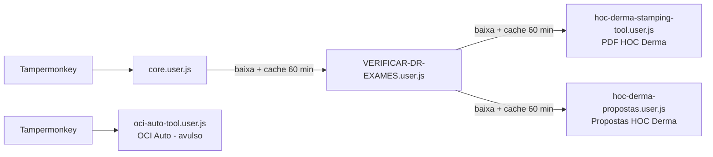

# 🩺 Feegow: Suíte de Aprimoramentos

<div align="center">


</div>

---

## 📑 Índice

- [📋 Sobre](#-sobre)
- [🧩 Módulos](#-módulos)
- [📦 Instalação](#-instalação)
- [🔗 Como funciona a cascata](#-como-funciona-a-cascata)
- [⚙️ Configurações (engrenagem)](#️-configurações-engrenagem)
- [🚀 Suite principal (VERIFICAR-DR-EXAMES)](#-suite-principal-verificar-dr-exames)
- [📄 PDF HOC Derma — Timbrador](#-pdf-hoc-derma--timbrador)
- [🖨️ Propostas HOC Derma](#️-propostas-hoc-derma)
- [🧾 OCI Auto](#-oci-auto)
- [🐛 Solução de problemas](#-solução-de-problemas)
- [🛠️ Desenvolvimento e testes](#️-desenvolvimento-e-testes)
- [🗒️ Changelog resumido](#️-changelog-resumido)
- [🤝 Contribuição](#-contribuição)
- [📝 Licença](#-licença)

---

## 📋 Sobre

Conjunto de **UserScripts** (Tampermonkey) que acrescentam recursos à plataforma **Feegow**, sem alterar o sistema original.

* A **Suite principal** cuida da lista de espera (contagem de pacientes exclusivos do **DR. EXAMES**), da limpeza da interface, do login com sessão dupla e de atalhos visuais.
* Os módulos **HOC Derma** timbram PDFs e imprimem propostas com o timbrado da clínica.
* O **OCI Auto** preenche a ficha OCI/APAC a partir do prontuário.

Tudo roda no navegador. Os módulos de impressão só leem a tela: **nada é gravado no Feegow**.

---

## 🧩 Módulos

| Arquivo | O que faz | Versão | Como é carregado |
| :--- | :--- | :---: | :--- |
| `core.user.js` | Injetor: baixa a Suite do GitHub e guarda em cache | 1.1.0.1 | Instalado no Tampermonkey (**recomendado**) |
| `VERIFICAR-DR-EXAMES.user.js` | Suite principal (lista de espera, engrenagem, login, atalhos) | 4.9.5.0 | Em cascata pelo core, ou avulso |
| `hoc-derma-stamping-tool.user.js` | **PDF HOC Derma**: carimba cabeçalho e rodapé HOC Derma em qualquer PDF | 3.1.0 | Em cascata pela Suite, ou avulso |
| `hoc-derma-propostas.user.js` | **Propostas HOC Derma**: botão "Imprimir HOC Derma" nas propostas | 1.0.1 | Em cascata pela Suite, ou avulso |
| `oci-auto-tool.user.js` | **OCI Auto**: ficha OCI/APAC em PDF a partir do prontuário | 1.0.0 | **Só avulso** (fora da cascata) |

Cada `.user.js` tem um `.meta.js` correspondente, usado pelo Tampermonkey (`@updateURL`) para checar novas versões.

---

## 📦 Instalação

**Pré-requisito:** extensão **Tampermonkey** no navegador.
[Chrome](https://chrome.google.com/webstore/detail/tampermonkey/dhdgffkkebhmkfjojejmpbldmpobfkfo) | [Firefox](https://addons.mozilla.org/pt-BR/firefox/addon/tampermonkey/) | [Edge](https://microsoftedge.microsoft.com/addons/detail/tampermonkey/dhdgffkkebhmkfjojejmpbldmpobfkfo)

### ✅ Recomendado: cascata com o core

1. Instale **apenas** o `core.user.js` (abra o link *raw* do arquivo no GitHub e confirme no Tampermonkey).
2. Abra o Feegow. O core baixa a Suite, e a Suite baixa o PDF HOC Derma e o Propostas HOC Derma.
3. Pronto: as atualizações chegam sozinhas (ver [Como funciona a cascata](#-como-funciona-a-cascata)).

### 🔧 Instalação avulsa

Para usar um módulo sem a cascata (ou testar uma versão local):

1. Tampermonkey → *Criar novo script*.
2. Apague o conteúdo padrão, cole o arquivo desejado e salve (`Ctrl + S`).

> ⚠️ Não instale o `VERIFICAR-DR-EXAMES.user.js` avulso **junto** com o core: a Suite rodaria duas vezes.
>
> O **OCI Auto** sempre é instalado à parte, com ou sem o core.

---

## 🔗 Como funciona a cascata



* Cada nível baixa o arquivo de `raw.githubusercontent.com` com `GM_xmlhttpRequest`, guarda o código no **cofre do Tampermonkey** (`GM_setValue`) e executa com `eval`.
* **Cache de 60 minutos** por nível. Dentro do prazo, o código roda direto da memória local (instantâneo). Depois, é baixado de novo.
* O PDF HOC Derma e o Propostas só são baixados se estiverem **ON** na engrenagem.
* **Forçar atualização:** não há botão para isso. Apague as chaves de horário no cofre (ver [Solução de problemas → O cache não atualiza](#-solução-de-problemas)) e recarregue a página.

<details>
<summary><strong>Chaves usadas no cofre do Tampermonkey</strong></summary>

| Chave | Quem grava | Conteúdo |
| :--- | :--- | :--- |
| `cached_script` / `last_fetch_time` | core | Código da Suite e horário do download |
| `hoc_derma_codigo` / `hoc_derma_fetch_time` / `hoc_derma_versao` | Suite | Código, horário e `@version` do PDF HOC Derma |
| `hoc_propostas_codigo` / `hoc_propostas_fetch_time` / `hoc_propostas_versao` | Suite | Código, horário e `@version` do Propostas |
| `dr_exames_status`, `remove_*`, `pdf_hoc_derma`, `propostas_hoc_derma` | Suite | Preferências da engrenagem |

Na cascata, a Suite roda dentro do core, então **todas** essas chaves ficam no armazenamento do **core**. Com a Suite avulsa, ficam no armazenamento dela.

</details>

---

## ⚙️ Configurações (engrenagem)

A Suite adiciona um botão de engrenagem (`#btn-controle-feegow`) na barra superior do Feegow, em qualquer tela. Cada item alterna entre ON e OFF e **recarrega a página**. As escolhas valem por computador (ficam no Tampermonkey).

| Item do menu | O que faz quando ON | Padrão |
| :--- | :--- | :---: |
| **DR. EXAMES (Lista de Espera)** | Conta e lista os pacientes exclusivos do DR. EXAMES. Em OFF, não consulta a API | ON |
| **Avisos Amarelos** | Remove os alertas amarelos (`.alert-warning`) | ON |
| **Notificações Flutuantes** | Remove as notificações flutuantes (`.ui-pnotify`) | ON |
| **Barra DP Spaces** | Remove a barra DP Spaces / Doctoralia | ON |
| **IA Feegow** | Remove o plugin do assistente de IA | ON |
| **Anúncios Feegow** | Remove os anúncios do Beamer (novidades, descontos) | ON |
| **Pedir Notificações** | Remove o modal que pede permissão de notificação push | ON |
| **PDF HOC Derma (v3)** | Mostra o botão vermelho **PDF HOC Derma** e carrega o timbrador | ON |
| **Imprimir HOC Derma (Propostas)** | Carrega o módulo de impressão das propostas | ON |

---

## 🚀 Suite principal (VERIFICAR-DR-EXAMES)

### 🧠 Lista de espera e DR. EXAMES

Funciona na **Lista de Espera** (URL com `p=listaespera&pers=1`).

* **Pacientes exclusivos:** a cada **10 s**, compara duas consultas à lista de espera (`ProfissionalID=ALL` × `ProfissionalID=1083`) e mostra quem está só na fila do DR. EXAMES.
* **Contador colorido:** fica ao lado de "pacientes aguardando". A cor vai do verde ao vermelho entre 1 e 5 pacientes e fica **vermelha** acima de 5. Sem exclusivos, mostra "Nenhum paciente exclusivo do DR. EXAMES".
* **Listas inteligentes:** a lista de exclusivos aparece no topo. Uma cópia surge **abaixo da tabela** quando a lista do topo sai da tela (`IntersectionObserver`). O botão **Esconder/Mostrar Listas DR. EXAMES** alterna a exibição.
* **Badge "Primeira vez"** para pacientes nessa situação. Os nomes são links para o prontuário.
* **30 itens por página:** a lista de espera é mantida sempre em 30.

### 🎨 Atalhos visuais

* **Especialidade do médico:** na tabela da lista de espera, uma tag ao lado do nome (🟢 verde neon para Oftalmologia, 🔴 vermelho para as demais). Nos menus suspensos de profissional, a especialidade aparece como texto abaixo do nome.
* **👁️ Dilatar (clique aqui):** badge laranja ao lado do médico que tem protocolo de dilatação cadastrado, **se a idade do paciente se encaixar** na regra dele. O clique abre um balão com o protocolo.
* **📄 Prontuário na Agenda:** botão ao lado do nome do paciente na Agenda que abre o prontuário em nova aba.
* **PDF HOC Derma:** botão vermelho à **esquerda da engrenagem** e também no painel **Arquivos do Paciente**.

### ⚡ Login com sessão dupla

Quando o Feegow mostra *"Este usuário já está conectado em outra máquina"*, a Suite exibe uma tela de carregamento e repete o login em segundo plano (Fetch API), sem recarregar o navegador. Assim que a sessão é liberada, você entra.

* Ela **não derruba** a sessão do outro computador; só repete a tentativa.
* Os dados do login são guardados temporariamente no `sessionStorage` da aba, a partir do clique em **Entrar**, e apagados depois do acesso.

<details>
<summary><strong>Detalhes técnicos e personalização</strong></summary>

**Tecnologias**

| Tecnologia | Uso |
| :--- | :--- |
| `MutationObserver` | Reinjeta botões e remove elementos a cada mudança do DOM |
| `IntersectionObserver` | Mostra a lista inferior quando a superior sai da tela |
| Fetch API + `DOMParser` | Consulta a lista de espera em segundo plano e lê o HTML retornado |
| `sessionStorage` | Guarda temporariamente os dados do login para a nova tentativa |
| `GM_getValue` / `GM_setValue` | Preferências da engrenagem e cache da cascata |

**Variáveis no código** (`VERIFICAR-DR-EXAMES.user.js`)

```javascript
let exibirTodos = 1;                // 0: mostra todos | 1: apenas exclusivos DR. EXAMES
const debugMode = 1;                // 1: logs no console (F12)
const intervaloVerificacao = 10000; // intervalo de atualização em ms (10 s)
```

Na cascata, o código vem do GitHub: altere o arquivo no repositório (ou use a Suite avulsa) para a mudança valer.

**Médicos e protocolos**

* `profissionais`: mapeia nome → especialidade. `"Oftalmologia"` gera a tag verde; qualquer outra, a vermelha.
* `protocolosDilatacao`: texto (HTML) do protocolo de cada médico.
* `verificarIdadeCompativel()`: faixa de idade em que o badge de dilatação aparece.

```javascript
const profissionais = {
    "NOME DO MÉDICO": "Oftalmologia", // tag verde
    "OUTRO MÉDICO": "Dermatologia"    // tag vermelha
};
```

</details>

---

## 📄 PDF HOC Derma — Timbrador

`hoc-derma-stamping-tool.user.js` (v3.1.0) abre uma janela flutuante dentro do Feegow que carimba o **cabeçalho e o rodapé HOC Derma** em qualquer PDF.

* **Abrir:** botão vermelho **PDF HOC Derma** (navbar ou painel Arquivos do Paciente) ou `Ctrl + Shift + H`. Se o timbrador ainda não carregou, o botão baixa e abre em seguida. Ele nunca redireciona para a página de instalação.
* **Carregar o PDF:** escolha o arquivo ou arraste para a janela.
* **⚡ AUTO — encaixar entre os timbres:** mede o conteúdo e ajusta deslocamento e altura para o texto caber entre cabeçalho e rodapé. Roda ao abrir cada PDF (opção **Aplicar AUTO ao abrir cada PDF**). Qualquer ajuste manual desliga o AUTO.
* **Ajuste manual:** arraste a folha ou use as setas (`Shift` = passo de 10). **Topo** e **Base** esticam ou encolhem cada metade do conteúdo; as alças **TOPO** e **BASE** na folha fazem o mesmo.
* **Por documento | Por página:** em *Por página*, cada folha tem seus próprios valores. Troque de página com ◀/▶, `Alt + ↑/↓` ou rolando.
* **📥 Exportar PDF nativo:** baixa `<nome>_timbrado.pdf` com o **texto selecionável**.
* **🖨️ Imprimir:** usa o mesmo PDF nativo, aberto em nova aba. Se falhar (PDF com senha, pop-up bloqueado), usa a impressão rasterizada antiga.
* **Menu ⋯:** modo de impressão (Automático / Sempre nesta janela / Sempre em nova aba), **🧪 Diagnóstico** e **🔃 Recarregar PDF**.
* **Avulso:** sem a Suite, o timbrador cria a própria pílula "PDF HOC Derma" na navbar, sem duplicar quando a Suite está presente.

Os ajustes ficam salvos no `localStorage` (por arquivo e por página).

<details>
<summary><strong>Detalhes técnicos</strong></summary>

* A interface roda num `<iframe>` same-origin; no Feegow só é criado o `#hocderma-root`.
* **Sem CDN:** pdf.js, o worker e o **pdf-lib 1.17.1** vão embutidos no arquivo (gzip + base64). Por isso não há `@require`, e o timbrador funciona na cascata (que só faz `eval`) e com CDNs bloqueados. O custo é o tamanho: ~1,3 MB.
* O preview é rasterizado (pdf.js + canvas). A exportação monta um PDF novo com pdf-lib: cada página original entra como *Form XObject* e os timbres são desenhados por cima, com a mesma transformação do preview.
* Chaves no `localStorage`: `hocderma:v3:cfg`, `hocderma:v3:offsets` e `hocderma:v3:ui`.
* API: `window.HOC_DERMA` (`abrir`, `fechar`, `alternar`, `imprimir`, `diagnostico`, `auto`, `exportar`, `montarPdf`, `estado`, entre outros).

</details>

---

## 🖨️ Propostas HOC Derma

`hoc-derma-propostas.user.js` (v1.0.1) imprime a proposta do prontuário com o timbrado HOC Derma, sem a tabela padrão do Feegow.

* **Onde aparece:** na proposta do prontuário (`form#frmProposta`), o botão vermelho **Imprimir HOC Derma** fica logo depois do grupo de impressão padrão. Como a proposta entra por AJAX, um `MutationObserver` recoloca o botão sem duplicar.
* **Editor antes de imprimir:** lê paciente, data, profissional, itens (qtd, unitário, desconto, acréscimo, total), desconto total, forma de pagamento, outras despesas e texto complementar. Dá para alterar, remover ou acrescentar valores **só na impressão**. Mostra o "Total no Feegow" e se ele confere com o editado.
* **Padrões:** colunas de desconto e acréscimo **desligadas** (o valor entra no unitário impresso), **validade ligada** (30 dias) e assinatura da clínica com o nome de **"Criado por …"** da proposta (editável).
* **Folha:** A4 com o timbrado oficial HOC Derma (os mesmos PNGs do timbrador). As **Observações Internas nunca são lidas nem impressas**.
* **Impressão:** num iframe oculto, sem abrir nova aba.

<details>
<summary><strong>Detalhes técnicos</strong></summary>

* API: `window.HOCDERMA_PROPOSTAS` (`lerProposta`, `abrirEditor`, `calcular`, `montarHtmlImpressao`, `imprimir`, `varrer`, `desligar`, `estado`).
* Opções de teste: `window.__HOCDERMA_PROPOSTAS_OPCOES__ = { somentePaciente: '<id>', modoTeste: true }` limita o botão a um paciente e mostra a faixa "MODO TESTE".
* `window.__HOCDERMA_PROPOSTAS_HOOKS__.dispararPrint(win, html)` substitui o `print()` real.

</details>

---

## 🧾 OCI Auto

`oci-auto-tool.user.js` (v1.0.0, ~700 KB) preenche a ficha OCI/APAC com os dados do prontuário. É instalado **à parte** (não entra na cascata) e não usa CDN.

* **Onde aparece:** só no prontuário (`?p=pacientes&i=<id>&pers=1`, maiúsculas ou minúsculas). A pílula **🧾 OCI Auto** fica no canto inferior direito. Trocar de paciente relê o prontuário sozinho.
* **O que faz:** lê o prontuário, mostra os **58 campos** da ficha para conferência, deixa escolher a assinatura entre as **24** dos médicos e monta o PDF sobre o formulário OCI em branco.
* **Saída:** **Imprimir** (iframe oculto) ou **⬇️ Baixar PDF** (`OCI_<PACIENTE>.pdf`).
* **Importante:** os campos são lidos por heurística. Se algum vier vazio, digite no painel; o PDF usa exatamente o que está lá. A assinatura é opcional.

<details>
<summary><strong>Detalhes técnicos</strong></summary>

* PDF base, 24 assinaturas (PNG) e **pdf-lib 1.17.1** vão embutidos (gzip + base64, descompactados com `DecompressionStream`). O CDN só é usado se o navegador não tiver `DecompressionStream`.
* Coordenadas tiradas do mapeamento `fields_oci_v2.json`, com o passo das caixinhas (*comb*) medido para CPF, CNS, código de procedimento, telefone, DDD e CEP.
* Nos campos "DOCUMENTO", o script marca um X em ( )CNS ou ( )CPF em vez de escrever o texto.
* API: `window.OCI_AUTO` (`gate`, `extrair`, `montarPdf`, `gerar`, `imprimir`, `baixar`, `dados`, `campos`, `comb`, `assinaturas`, `selecionarAssinatura`).

</details>

---

## 🐛 Solução de problemas

<details>
<summary><strong>O botão (engrenagem, PDF HOC Derma) não aparece</strong></summary>

* Confira se o script está **ativo** no Tampermonkey e se a URL é do Feegow (`https://*.feegow.com/...`).
* A engrenagem se ancora no Caixa, em Tarefas ou no sino da barra superior. Se nenhum deles existir, ela não é criada (o console mostra "Nenhum ponto de ancoragem encontrado").
* Os botões da navbar ficam **ocultos em telas estreitas** (classes `hidden-sm hidden-xs` do Feegow). Aumente a janela.
* O PDF HOC Derma e o Propostas precisam estar **ON** na engrenagem.
* O contador DR. EXAMES só aparece na Lista de Espera e com a opção ON. O OCI Auto só aparece no prontuário.

</details>

<details>
<summary><strong>O cache não atualiza</strong></summary>

O código novo do GitHub só chega **60 minutos** depois do último download. Para forçar:

1. Tampermonkey → Painel → **Configurações** → *Modo de configuração*: **Avançado**.
2. Abra o script **core** (ou a Suite, se estiver avulsa) → aba **Armazenamento**.
3. Apague as chaves do módulo e salve:
   * Suite: `last_fetch_time` (ou `cached_script`)
   * PDF HOC Derma: `hoc_derma_fetch_time` (ou `hoc_derma_codigo`)
   * Propostas: `hoc_propostas_fetch_time` (ou `hoc_propostas_codigo`)
4. Recarregue o Feegow.

Se o console mostrar **"Erro ao rodar o script salvo no cache"**, apague `cached_script`: o core guarda a resposta do GitHub sem checar se o download deu certo.

</details>

<details>
<summary><strong>Pop-up de impressão bloqueado</strong></summary>

* **PDF HOC Derma:** o Imprimir abre o PDF em nova aba. Se o navegador bloquear, ele avisa e usa a impressão antiga. Libere pop-ups para o Feegow ou, no menu ⋯, escolha **Sempre nesta janela**.
* **OCI Auto:** se a impressão do iframe for bloqueada, use **⬇️ Baixar PDF**.
* **Propostas:** imprime num iframe oculto e não depende de pop-up.
* O **🧪 Diagnóstico** do timbrador (menu ⋯) mostra o que está falhando; o detalhe vai para o console.

</details>

<details>
<summary><strong>Rodar sem internet</strong></summary>

* **Dentro dos 60 min** do último download, a cascata roda do cache sem rede.
* **Depois disso**, sem rede, o core não executa a Suite e o PDF HOC Derma não carrega (o cache vencido não é reaproveitado). Só o Propostas usa o cache vencido como reserva.
* O timbrador e o OCI Auto não dependem de CDN. Instalados **avulsos**, funcionam sem acesso ao GitHub.
* A contagem DR. EXAMES, o login e o prontuário dependem do próprio Feegow online.

</details>

<details>
<summary><strong>Outros</strong></summary>

* **Lista inferior não aparece:** role até a lista do topo sair da tela.
* **"Erro ao buscar dados da API" no console:** verifique a conexão ou se a sessão do Feegow expirou.
* **Login automático não disparou:** os dados só são capturados no clique em **Entrar**. Um preenchimento automático externo que pule o botão impede a nova tentativa.

</details>

---

## 🛠️ Desenvolvimento e testes

* **Sintaxe:** `node --check <arquivo>.user.js` antes de publicar.
* **Versão:** ao mudar um script, atualize o `@version` no `.user.js` **e** no `.meta.js`.
* **Testar sem esperar o cache:** instale a versão local avulsa no Tampermonkey (desative o core) ou limpe as chaves do cofre.
* **Logs:** com `debugMode = 1`, a Suite registra tudo no console (F12) com o prefixo `[Script Tampermonkey]`.
* **Ganchos de teste:**
  * Timbrador: `window.HOC_DERMA.diagnostico()`, `montarPdf()` e `abrirArquivo()`.
  * Propostas: `window.__HOCDERMA_PROPOSTAS_OPCOES__` e `window.__HOCDERMA_PROPOSTAS_HOOKS__`.
  * OCI Auto: `window.__OCI_AUTO_HOOKS__ = { baixar: (bytes, nome) => ... }` captura o PDF sem abrir diálogo.

---

## 🗒️ Changelog resumido

| Data / versão | Mudança |
| :--- | :--- |
| 2026-11-20 · Propostas 1.0.1 | Toggle lido com a mesma chave da engrenagem (`propostas_hoc_derma`), `@match` para `feegow.com.br` e README reescrito |
| 2026-11-20 · Suite 4.9.5.0 · Propostas 1.0.0 | Novo **Propostas HOC Derma** em cascata, com item na engrenagem; correção do padrão dos toggles (o 1º clique em PDF HOC Derma não mudava nada) |
| 2026-11-02 · OCI Auto 1.0.0 | Nova ficha **OCI/APAC** do prontuário com 58 campos, assinatura e impressão |
| Timbrador 3.1.0 | Exportação **PDF nativo** com texto selecionável (pdf-lib embutido); o Imprimir passa a usar o PDF nativo |
| Timbrador 3.0.7 | Ajuste **Por página** |
| Timbrador 3.0.6 | **⚡ AUTO** encaixa o conteúdo entre os timbres |
| Timbrador 3.0.5 | Sem botão flutuante: acesso só pela navbar |

---

## 🤝 Contribuição

Contribuições são bem-vindas!

1. Faça um Fork do projeto.
2. Crie uma Branch para sua Feature (`git checkout -b feature/Incrivel`).
3. Faça o Commit (`git commit -m 'Add some Incrivel'`).
4. Push para a Branch (`git push origin feature/Incrivel`).
5. Abra um Pull Request.

---

## 📝 Licença

Distribuído sob a licença **MIT**. Veja `LICENSE` para mais informações.

<div align="center">
<sub>Feito com ❤️ por Nicolas Bonza Cavalari Borges</sub>
</div>
