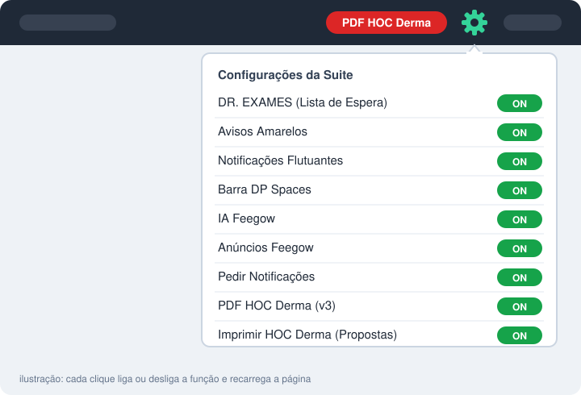
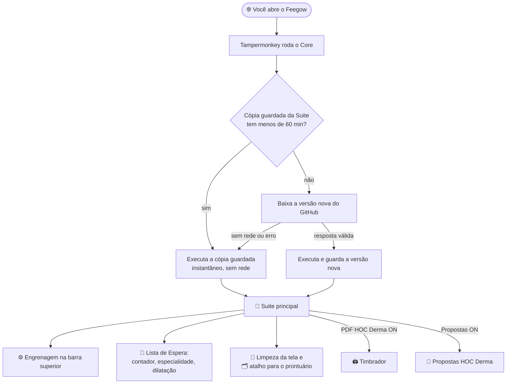

<p align="center">
  
</p>

<h1 align="center">🧩 Feegow Enhanced Suite</h1>

<p align="center">
  <b>O Feegow do jeito que a recepção precisa.</b><br>
  Um conjunto de userscripts que acrescenta ao Feegow contador de fila, tela mais limpa, atalhos, papel timbrado em PDF e propostas prontas para imprimir, <b>sem mudar nada no sistema</b>.
</p>

<p align="center">
  
  
  
  
  <a href="LICENSE"></a>
  
</p>

<p align="center">
  <a href="https://raw.githubusercontent.com/Nicker2/Feegow-Enhanced-Suite/main/core.user.js"><b>⬇️ Instalar o Core</b></a>
  &nbsp;·&nbsp;
  <a href="#-instalação">📦 Instalar</a>
  &nbsp;·&nbsp;
  <a href="#-configuração">⚙️ Configurar</a>
  &nbsp;·&nbsp;
  <a href="#-solução-de-problemas">🩹 Problemas</a>
</p>

---

## 📑 Sumário

- [✨ O que faz](#-o-que-faz)
- [📚 Os scripts](#-os-scripts)
- [🧭 Como funciona](#-como-funciona)
- [📋 Requisitos](#-requisitos)
- [📦 Instalação](#-instalação)
- [🔧 Configuração](#-configuração)
- [🚀 Como usar no dia a dia](#-como-usar-no-dia-a-dia)
- [🔒 Privacidade](#-privacidade)
- [🩹 Solução de problemas](#-solução-de-problemas)
- [❓ Perguntas frequentes](#-perguntas-frequentes)
- [🧰 Para quem mantém](#-para-quem-mantém)
- [🤝 Contribuição](#-contribuição)
- [📄 Licença e autor](#-licença-e-autor)

---

## ✨ O que faz

São **userscripts** para a extensão Tampermonkey. Eles rodam **no seu navegador**, mudam só o que você vê na tela e **nunca gravam nada no Feegow**. Foram escritos para a rotina do HOC (oftalmologia e HOC Derma), mas qualquer usuário do Feegow consegue instalar.

| | Recurso | Em poucas palavras |
| :---: | :--- | :--- |
| 🔢 | **Contador do DR. EXAMES** | Na Lista de Espera, mostra ao lado de "pacientes aguardando" quantos estão **só** na fila do DR. EXAMES, com cor de alerta e a lista de nomes (com link para o prontuário e selo "Primeira vez"). Atualiza a cada 10 s. |
| 🩺 | **Especialidade e dilatação** | Etiqueta com a especialidade ao lado do nome do médico e selo laranja **Dilatar (clique aqui)** quando o protocolo de dilatação do médico vale para a idade do paciente. |
| 📄 | **Sempre 30 por página** | A Lista de Espera fica sempre com 30 itens por página. |
| 🗂️ | **Prontuário a um clique** | Na agenda, um botão ao lado do paciente abre o prontuário em nova aba, sem sair da agenda. |
| 🧹 | **Tela mais limpa** | Esconde avisos amarelos, notificações flutuantes, barra DP Spaces/Doctoralia, assistente de IA, anúncios e o pedido de notificações. |
| 🔑 | **Entrada sem dor de cabeça** | Quando o Feegow diz que o usuário *já está conectado em outra máquina*, a Suite mostra uma tela de espera e tenta entrar sozinha por cerca de 1 minuto. Senha errada é avisada na hora. |
| ⚙️ | **Engrenagem de configurações** | Um botão na barra superior liga e desliga cada função, por computador. |
| 🖨️ | **PDF HOC Derma (Timbrador)** | Aplica o cabeçalho e o rodapé HOC Derma em **qualquer PDF**, encaixa o conteúdo sozinho e exporta um PDF com texto selecionável. O arquivo não sai do computador. |
| 💼 | **Propostas HOC Derma** | Botão **Imprimir HOC Derma** na proposta do prontuário: editor com prévia A4, descrição de cada procedimento, valores editáveis só para a impressão e timbrado HOC Derma. |
| 🔄 | **Atualiza sozinho** | Instalando só o Core, uma versão nova chega a todos os computadores em até cerca de 1 hora. Sem internet, roda a última cópia guardada. |

<p align="center">
  <br>
  <sub>Ilustração do menu de engrenagem (desenho, sem dados reais).</sub>
</p>

---

## 📚 Os scripts

| Script | Para que serve | Versão | Instalar |
| :--- | :--- | :---: | :--- |
| 🚀 **Core** (`core.user.js`) | Injetor: baixa a Suite do GitHub, guarda em cache e executa. É o **único** que você precisa instalar para ter a Suite, o Timbrador e as Propostas. | 1.1.1.0 | [instalar](https://raw.githubusercontent.com/Nicker2/Feegow-Enhanced-Suite/main/core.user.js) |
| 🧩 **Suite principal** (`VERIFICAR-DR-EXAMES.user.js`) | Contador do DR. EXAMES, especialidade e dilatação, engrenagem, limpeza da tela, atalho para o prontuário e entrada com sessão ocupada. | 4.9.5.2 | carregada pelo Core ([avulsa](https://raw.githubusercontent.com/Nicker2/Feegow-Enhanced-Suite/main/VERIFICAR-DR-EXAMES.user.js)) |
| 🖨️ **PDF HOC Derma** (`hoc-derma-stamping-tool.user.js`) | Janela que aplica o timbrado HOC Derma em qualquer PDF, ajusta o encaixe e exporta ou imprime. | 3.1.0 | carregado pela Suite ([avulso](https://raw.githubusercontent.com/Nicker2/Feegow-Enhanced-Suite/main/hoc-derma-stamping-tool.user.js)) |
| 💼 **Propostas HOC Derma** (`hoc-derma-propostas.user.js`) | Botão **Imprimir HOC Derma** na proposta do prontuário, com editor e folha A4 timbrada. | 1.3.8 | carregado pela Suite ([avulso](https://raw.githubusercontent.com/Nicker2/Feegow-Enhanced-Suite/main/hoc-derma-propostas.user.js)) |

A versão vigente de cada script é a do `@version` no respectivo `.meta.js`.

---

## 🧭 Como funciona



A Suite carrega o Timbrador e as Propostas do mesmo jeito (cópia guardada por até 60 min), mas só quando o item está **ON** na engrenagem. Nenhum dos scripts grava no Feegow por conta própria: eles leem a tela e acrescentam botões e informações. A única exceção são as **Propostas**: o Imprimir HOC Derma clica no SALVAR da proposta antes de abrir o editor (desde a 1.3.5), e no editor o "＋ Feegow" de uma linha nova, as quantidades, valores, descontos e acréscimos dos itens e o desconto total gravam na proposta real, seguidos de SALVAR (1.3.6 e 1.3.7).

---

## 📋 Requisitos

| | Item | Observação |
| :---: | :--- | :--- |
| 🌐 | **Google Chrome** ou **Microsoft Edge** | Navegadores usados na rotina. O Firefox também tem Tampermonkey, mas não é o foco dos testes. |
| 🐒 | **Extensão Tampermonkey** | [Chrome Web Store](https://chrome.google.com/webstore/detail/tampermonkey/dhdgffkkebhmkfjojejmpbldmpobfkfo) · [Edge](https://microsoftedge.microsoft.com/addons/detail/tampermonkey/dhdgffkkebhmkfjojejmpbldmpobfkfo) · [Firefox](https://addons.mozilla.org/pt-BR/firefox/addon/tampermonkey/) |
| 🔑 | **Acesso ao Feegow** | Os scripts rodam em `https://<algo>.feegow.com/...` (ex.: `app.feegow.com`). |
| 📶 | **Internet na primeira vez** | Para baixar o código. Depois, sem internet, roda a última cópia guardada. |

---

## 📦 Instalação

### Recomendado: só o Core

1. Instale o **Tampermonkey** no navegador (links em [Requisitos](#-requisitos)).
2. Clique em **[⬇️ Instalar o Core](https://raw.githubusercontent.com/Nicker2/Feegow-Enhanced-Suite/main/core.user.js)**. O Tampermonkey abre a tela de instalação: clique em **Instalar**.
3. Abra o Feegow e recarregue a página (F5). O Core baixa a Suite, e a Suite baixa o Timbrador e as Propostas.
4. A **engrenagem** aparece na barra superior do Feegow. Pronto.

> [!NOTE]
> No Chrome recente, a extensão pode exigir o **Modo do desenvolvedor** ligado em `chrome://extensions` (ou a opção "Permitir scripts do usuário" nos detalhes da extensão) para executar userscripts.

### Instalação avulsa (sem o Core)

Cada script também funciona sozinho: abra o link *avulso* na [tabela dos scripts](#-os-scripts) e confirme no Tampermonkey. Use isso para testar um script isolado ou para ter só as Propostas, por exemplo.

> [!WARNING]
> **Não instale a Suite avulsa junto com o Core**: ela rodaria duas vezes. Também evite instalar o Timbrador ou as Propostas avulsos com o Core ativo e o item ON na engrenagem: os scripts evitam botões duplicados, mas o código carregaria duas vezes e as configurações ficariam separadas.

---

## 🔧 Configuração

### Engrenagem da Suite

Clique na **engrenagem** da barra superior. Cada clique liga ou desliga o item e **recarrega a página**. As escolhas valem **para aquele computador** e todas vêm ligadas.

| Item da engrenagem | Quando ON | Padrão |
| :--- | :--- | :---: |
| DR. EXAMES (Lista de Espera) | Contador e lista dos pacientes só do DR. EXAMES | ON |
| Avisos Amarelos | Esconde os avisos amarelos | ON |
| Notificações Flutuantes | Esconde as notificações flutuantes | ON |
| Barra DP Spaces | Esconde a barra DP Spaces / Doctoralia | ON |
| IA Feegow | Esconde o assistente de IA | ON |
| Anúncios Feegow | Esconde os anúncios de novidades | ON |
| Pedir Notificações | Esconde o pedido de permissão de notificações | ON |
| PDF HOC Derma (v3) | Carrega o Timbrador e mostra o botão vermelho **PDF HOC Derma** | ON |
| Imprimir HOC Derma (Propostas) | Carrega o módulo de Propostas | ON |

### Configurações das Propostas

No editor de propostas, botão **⚙ Configurações** (ou, com o script instalado avulso, no ícone do Tampermonkey → **Configurações das propostas**): nome e cargo de quem assina a folha, tabela de itens, total, investimento por procedimento, validade e linha de assinatura. Detalhes em [docs/hoc-derma-propostas.md](docs/hoc-derma-propostas.md#5-configurações-das-propostas).

### Ajustes do Timbrador

O Timbrador lembra o encaixe de cada PDF sozinho. Modo de impressão e diagnóstico ficam no menu **⋯** da janela. Detalhes em [docs/pdf-hoc-derma-timbrador.md](docs/pdf-hoc-derma-timbrador.md).

> [!TIP]
> A relação de médicos e especialidades e os protocolos de dilatação ficam no código da Suite. Para incluir um médico novo, veja [docs/suite-principal.md](docs/suite-principal.md#6-personalização-no-código).

---

## 🚀 Como usar no dia a dia

| Situação | O que fazer |
| :--- | :--- |
| Ver quem está só na fila do DR. EXAMES | Abra a **Lista de Espera**: o contador colorido aparece ao lado de "pacientes aguardando" e a lista fica no topo. O botão **Esconder/Mostrar Listas DR. EXAMES** alterna a exibição. |
| Saber se o paciente precisa dilatar | Na Lista de Espera, clique no selo laranja **Dilatar (clique aqui)** para ver o protocolo do médico. |
| Abrir o prontuário pela agenda | Clique no botão ao lado do nome do paciente: abre em nova aba. |
| Feegow diz "usuário já conectado em outra máquina" | Não faça nada: a tela de espera aparece e a Suite tenta entrar sozinha. Se a senha estiver errada, ela avisa e para. |
| Pôr o timbrado HOC Derma num PDF | Botão vermelho **PDF HOC Derma** (barra superior ou painel **Arquivos do Paciente**) ou `Ctrl + Shift + H` → escolha ou arraste o PDF → confira a prévia → **Exportar PDF nativo** ou **Imprimir**. |
| Imprimir uma proposta da HOC Derma | Prontuário → aba **Propostas** → abra a proposta → **Imprimir HOC Derma** → ajuste no editor → **Imprimir** (ou `Ctrl + Enter`). Para PDF, escolha **Salvar como PDF**. |
| Desligar uma função neste computador | Engrenagem → clique no item (vira OFF e a página recarrega). |

---

## 🔒 Privacidade

- **Nenhum script envia dados para servidores de terceiros.** Fora do Feegow, só baixam o próprio código do GitHub (e, raramente, uma biblioteca pública de PDF).
- **Nenhum script grava no Feegow.** Não há cadastro, edição ou exclusão de registros.
- **O PDF do Timbrador não sai do computador**: tudo é feito no navegador.
- **As Propostas leem a tela e clicam no SALVAR da proposta** (ao clicar em Imprimir HOC Derma, desde a 1.3.5). No editor, o "＋ Feegow" de uma linha nova, quantidades, valores, descontos e acréscimos dos itens e o desconto total gravam no Feegow (1.3.6/1.3.7); descrições e textos valem só para aquela impressão. As "Observações Internas" nunca são lidas nem impressas.
- **Entrada com sessão ocupada:** para tentar entrar de novo sozinha, a Suite guarda o usuário e a senha digitados **na própria aba**, até a entrada dar certo ou a aba ser fechada. Em computador compartilhado, feche a aba depois de sair do Feegow.

A análise completa, script por script, está em [docs/AVANCADO.md](docs/AVANCADO.md#privacidade-e-segurança).

---

## 🩹 Solução de problemas

| Sintoma | O que fazer |
| :--- | :--- |
| ⚙️ A engrenagem não aparece | Confira se o Core está **ativo** no Tampermonkey e se o endereço é `https://<algo>.feegow.com/...`. Em janela estreita o Feegow esconde os botões da barra: aumente a janela. |
| 🔴 O botão PDF HOC Derma ou Imprimir HOC Derma não aparece | Confira se o item está **ON** na engrenagem. O Imprimir HOC Derma só aparece na **proposta aberta no prontuário**. |
| 🐒 Instalei e nada acontece | No Chrome recente, ligue o **Modo do desenvolvedor** em `chrome://extensions` (ou "Permitir scripts do usuário" nos detalhes do Tampermonkey) e recarregue o Feegow. |
| ⏳ Publiquei uma versão e ela não chegou | Pela cascata, espere até 60 min ou force o download (passo a passo em [docs/AVANCADO.md](docs/AVANCADO.md#atualização-automática)). Instalação avulsa: **Verificar atualizações** no Tampermonkey; confira se o `@version` subiu também no `.meta.js`. |
| 🔑 A entrada automática não disparou | Os dados só são guardados quando você clica em **Entrar**. Um preenchimento automático que envie o formulário sozinho impede a nova tentativa: digite e clique em **Entrar**. |
| 🖨️ Impressão do Timbrador bloqueada | Libere pop-ups para o Feegow ou escolha **Sempre nesta janela** no menu **⋯**. O **Diagnóstico** (menu ⋯) mostra o que falha. |
| 📄 Saíram data e endereço do site na folha | Na janela de impressão, em "Mais configurações", desmarque **Cabeçalhos e rodapés**. |
| 🌐 Sem internet | A Suite roda a última cópia guardada, mesmo vencida. Só falha na primeira execução, com o cache vazio. |
| 🧾 "Erro ao buscar dados da API" no console | A conexão caiu ou a sessão do Feegow expirou: recarregue e entre de novo. |

Problemas específicos de cada script: [Suite](docs/suite-principal.md#7-problemas-comuns) · [Timbrador](docs/pdf-hoc-derma-timbrador.md#problemas-comuns) · [Propostas](docs/hoc-derma-propostas.md#9-solução-de-problemas).

---

## ❓ Perguntas frequentes

<details>
<summary><b>Os scripts podem estragar alguma coisa no Feegow?</b></summary>

Não. Eles só mudam o que aparece na tela do seu navegador: escondem elementos, acrescentam botões e leem informações que já estão na página. Nenhum deles cadastra, edita ou apaga registros.
</details>

<details>
<summary><b>Preciso instalar os quatro scripts?</b></summary>

Não. Instale só o **Core**: ele baixa a Suite, e a Suite baixa o Timbrador e as Propostas. Os links avulsos existem para testes ou para quem quer um script isolado.
</details>

<details>
<summary><b>Como fico sabendo de uma versão nova?</b></summary>

Não precisa ficar sabendo: com o Core, a versão nova chega sozinha em até cerca de 1 hora. O que mudou em cada versão está em [docs/HISTORICO.md](docs/HISTORICO.md).
</details>

<details>
<summary><b>Funciona sem internet?</b></summary>

O Feegow é on-line, então você precisa de internet para usá-lo. Mas, se o GitHub estiver fora ou a rede cair no meio do dia, a Suite continua rodando com a última cópia guardada.
</details>

<details>
<summary><b>Posso desligar só uma função?</b></summary>

Sim. Na engrenagem, clique no item para deixá-lo OFF. A escolha vale só para aquele computador.
</details>

<details>
<summary><b>Uso o Feegow em outra clínica. Serve para mim?</b></summary>

Serve. A limpeza da tela, a engrenagem, o atalho para o prontuário, a entrada com sessão ocupada e o Timbrador funcionam em qualquer conta do Feegow. O contador do DR. EXAMES, a relação de especialidades, os protocolos de dilatação e o timbrado HOC Derma são da rotina do HOC: para outra clínica, é preciso adaptar no código (veja [docs/suite-principal.md](docs/suite-principal.md#6-personalização-no-código)).
</details>

<details>
<summary><b>A proposta impressa muda alguma coisa na proposta do Feegow?</b></summary>

Não. Valores, textos e itens ajustados no editor valem só para aquela impressão. A proposta no Feegow continua como estava.
</details>

---

## 🧰 Para quem mantém

| Documento | Conteúdo |
| :--- | :--- |
| 📘 [docs/AVANCADO.md](docs/AVANCADO.md) | Cascata do Core, atualização, privacidade e segurança em detalhe, estrutura do repositório, testes offline e como publicar uma versão. |
| 🔗 [docs/core-e-cascata.md](docs/core-e-cascata.md) | Cache, chaves salvas no Tampermonkey, permissões e como forçar o download. |
| 🧩 [docs/suite-principal.md](docs/suite-principal.md) | Todas as funções da Suite e a personalização no código. |
| 🖨️ [docs/pdf-hoc-derma-timbrador.md](docs/pdf-hoc-derma-timbrador.md) | Guia completo do Timbrador. |
| 💼 [docs/hoc-derma-propostas.md](docs/hoc-derma-propostas.md) | Guia completo das Propostas, catálogo de procedimentos e manutenção. |
| 📜 [docs/HISTORICO.md](docs/HISTORICO.md) | Histórico de versões. |

Atalhos:

```bash
node --check VERIFICAR-DR-EXAMES.user.js   # confere a sintaxe antes de publicar
python montar_userscripts.py               # (pasta de trabalho) gera o userscript das Propostas
git pull --rebase origin main && git push origin main
```

> [!IMPORTANT]
> Ao publicar, aumente o `@version` **no `.user.js` e no `.meta.js`** (os dois precisam ser iguais). Sem isso, o Tampermonkey não percebe a versão nova.

---

## 🤝 Contribuição

Contribuições são bem-vindas:

1. Faça um **fork** e crie uma branch (`git checkout -b minha-melhoria`).
2. Faça as alterações e rode `node --check` nos arquivos alterados.
3. Teste com o script instalado avulso (e o Core desativado).
4. Abra um **Pull Request** explicando o que mudou e por quê.

> [!CAUTION]
> Este repositório é **público**, e o código publicado aqui roda no navegador de quem usa o Core. Nunca envie senhas, tokens, capturas de tela ou qualquer dado de pacientes.

---

## 📄 Licença e autor

Distribuído sob a **Licença MIT**. Veja [LICENSE](LICENSE).

As Propostas HOC Derma embutem as fontes Poppins, Montserrat, Open Sans, Roboto e Lato (Google Fonts, subconjunto latino), distribuídas sob a **SIL Open Font License 1.1**. As licenças estão em [assets/fontes/](assets/fontes/).

Criado por **Nicolas Bonza Cavalari Borges**.
