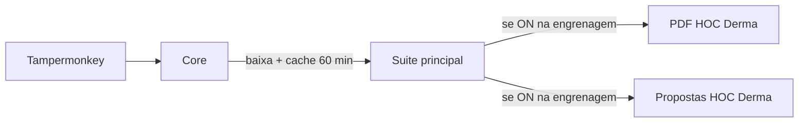

# 🛠️ Detalhes técnicos e manutenção

> Voltar para o [README](../README.md). Aqui fica o que interessa a quem mantém a suíte: como o Core carrega os outros scripts, o que cada script acessa, a estrutura do repositório, como testar e como publicar uma versão.

## Sumário

- [Guias por script](#guias-por-script)
- [Como o Core carrega a Suite](#como-o-core-carrega-a-suite)
- [Atualização automática](#atualização-automática)
- [Privacidade e segurança](#privacidade-e-segurança)
- [Estrutura do repositório](#estrutura-do-repositório)
- [Geração das Propostas (`montar_userscripts.py`)](#geração-das-propostas-montar_userscriptspy)
- [Testar offline](#testar-offline)
- [Publicar uma versão](#publicar-uma-versão)

---

## Guias por script

| Documento | Conteúdo |
| :--- | :--- |
| [core-e-cascata.md](core-e-cascata.md) | Como o Core e a Suite baixam os outros scripts, cache, chaves salvas no Tampermonkey e como forçar o download. |
| [suite-principal.md](suite-principal.md) | Todas as funções da Suite, o menu de engrenagem e a personalização no código. |
| [pdf-hoc-derma-timbrador.md](pdf-hoc-derma-timbrador.md) | Guia completo do Timbrador: ajuste, exportação, impressão e detalhes técnicos. |
| [hoc-derma-propostas.md](hoc-derma-propostas.md) | Guia completo das Propostas HOC Derma: editor, configurações, catálogo de procedimentos e manutenção. |
| [HISTORICO.md](HISTORICO.md) | Histórico de versões. |

---

## Como o Core carrega a Suite

`core.user.js` não tem interface. Em cada página do Feegow (`https://*.feegow.com/*/*`) ele:

1. verifica se a cópia da Suite guardada no armazenamento do Tampermonkey tem menos de 60 minutos; se tiver, executa direto (instantâneo);
2. se venceu (ou é a primeira vez), baixa a Suite do GitHub. Só aceita a resposta se vier com HTTP 200 e cabeçalho de userscript, executa e só então guarda no cache;
3. sem rede, com o GitHub fora ou se a versão nova falhar ao iniciar, executa a cópia guardada, mesmo vencida.

Por isso a Suite continua funcionando sem internet, exceto na primeiríssima execução. A Suite usa o mesmo algoritmo para carregar o Timbrador e as Propostas, quando o item correspondente está ON na engrenagem.



Detalhes, chaves de cache e permissões: [core-e-cascata.md](core-e-cascata.md).

---

## Atualização automática

| Mecanismo | Vale para | Como funciona |
| :--- | :--- | :--- |
| **Cascata com cache de 60 min** | Suite, Timbrador e Propostas carregados pelo Core | A cada carregamento do Feegow, se o código salvo tiver mais de 60 minutos, ele é baixado de novo de `raw.githubusercontent.com`. Uma versão publicada chega a todos os computadores em até cerca de 1 hora, sem ninguém fazer nada. |
| **`@updateURL` do Tampermonkey** | O próprio Core e qualquer script instalado avulso | O Tampermonkey consulta o `.meta.js` periodicamente (ou em **Verificar atualizações**) e instala a versão nova quando o `@version` aumenta. |

**Forçar o download na hora (cascata):** Tampermonkey → Painel → **Configurações** → *Modo de configuração*: **Avançado** → abra o script **Core** → aba **Armazenamento** → apague `last_fetch_time` (Suite), `hoc_derma_fetch_time` (Timbrador) ou `hoc_propostas_fetch_time` (Propostas) → salve e recarregue o Feegow.

---

## Privacidade e segurança

O que foi verificado no código de cada script:

| Script | Acessos de rede | Armazenamento local |
| :--- | :--- | :--- |
| Core | Só `GET` em `raw.githubusercontent.com` (o próprio código da Suite). Nenhum dado é enviado. | Código da Suite e horário do download, no armazenamento do Tampermonkey. |
| Suite | `GET` em `raw.githubusercontent.com` (código do Timbrador e das Propostas). Consulta a lista de espera no **próprio Feegow** (`app.feegow.com`), com a sessão já aberta. No recurso de entrada com sessão ocupada, os dados de acesso digitados vão **só para a tela de login do próprio Feegow**. As imagens da tela de carregamento vêm dos servidores do Feegow. | Preferências da engrenagem e cache, no Tampermonkey. Os dados de acesso digitados ficam guardados temporariamente na própria aba (ver aviso abaixo). |
| PDF HOC Derma | Nenhum no uso normal: pdf.js e pdf-lib vão embutidos e o PDF é processado no navegador. Só se o navegador não suportar `DecompressionStream` (versões anteriores a 2020) ou bloquear workers `blob:`, baixa as mesmas bibliotecas de `cdnjs.cloudflare.com` / `unpkg.com`, sem cookies. | Ajustes por arquivo no `localStorage` do Feegow (`hocderma:v3:*`). |
| Propostas HOC Derma | Nenhum de gravação. Clica no SALVAR antes de imprimir (1.3.5); "＋ Feegow" usa a função `itens()` e a busca do select2 do próprio Feegow (só leitura), e o desconto total vai para o `#DescontoTotal`, ambos seguidos de SALVAR (1.3.6); qtd/valores/descontos/acréscimos dos itens vão para as linhas reais, com SALVAR (1.3.7). Fontes embutidas (Poppins e outras, SIL OFL, `assets/fontes/`). | Preferências no Tampermonkey. |

Em resumo:

- **Nenhum script envia dados para servidores de terceiros.** Os únicos destinos fora do Feegow são o GitHub (download do código) e, raramente, um CDN público de bibliotecas (download de código, sem cookies).
- **Nenhum script lê `document.cookie`.** As consultas ao Feegow usam a sessão do navegador, como qualquer página do Feegow.
- **Nenhum script grava no Feegow.** Não há cadastro, edição ou exclusão de registros.
- **Aviso sobre a entrada com sessão ocupada:** para poder tentar entrar de novo sozinha, a Suite guarda o usuário e a senha digitados na memória da própria aba, sem criptografia. Eles são apagados quando a entrada dá certo; se não, ficam até a aba ser fechada (essa memória some com a aba e não é compartilhada com outros sites). Em computador compartilhado, feche a aba depois de sair do Feegow.
- O código da cascata é executado com `eval` a partir do GitHub. Quem tem acesso de escrita a este repositório controla o que roda no navegador de quem usa o Core: proteja a conta do GitHub (senha forte e autenticação em dois fatores).

---

## Estrutura do repositório

```
core.user.js / core.meta.js                          Core (injetor da cascata)
VERIFICAR-DR-EXAMES.user.js / .meta.js               Suite principal
hoc-derma-stamping-tool.user.js / .meta.js           PDF HOC Derma (Timbrador)
hoc-derma-propostas.user.js / .meta.js               Propostas HOC Derma
hoc-gastos-excel.user.js / .meta.js                  HOC Gastos para Excel (avulso)
assets/                                              Imagens do README (desenhos SVG)
docs/                                                Guias por script, detalhes técnicos e histórico
LICENSE                                              MIT
```

- O `.user.js` é o script completo; o `.meta.js` contém **só** o bloco `// ==UserScript== ... // ==/UserScript==` e é o que o Tampermonkey consulta (`@updateURL`) para saber se há versão nova. `@downloadURL` aponta para o `.user.js`.
- Os scripts carregados em cascata rodam dentro do contexto do Core: usam as permissões (`@grant`) e o armazenamento do Core. Um recurso que dependa de `GM_registerMenuCommand`, por exemplo, só aparece quando o script está instalado avulso.
- O nome `VERIFICAR-DR-EXAMES.user.js` é histórico (primeira função da Suite); o nome exibido no Tampermonkey é "Suite Feegow Enhanced". Ele não deve ser renomeado, porque o Core e as instalações existentes apontam para esse caminho.

---

## Geração das Propostas (`montar_userscripts.py`)

O script de Propostas é desenvolvido como um módulo separado (`hoc-derma-propostas.js`) numa pasta de trabalho fora do repositório. O `montar_userscripts.py`, na mesma pasta:

1. lê a versão de `const VERSAO = '...'` do módulo;
2. gera o `TESTE-hoc-derma-propostas.user.js` (cabeçalho de teste + módulo, com `@version <versão>-teste`);
3. gera o `hoc-derma-propostas.user.js` do repositório (cabeçalho do repo, com o timbrado embutido em `window.HOCDERMA_TIMBRADO`, + módulo);
4. atualiza o `@version` de `hoc-derma-propostas.meta.js`.

Ele só grava arquivos locais: não faz commit nem push. Os outros scripts são editados diretamente no `.user.js`. O fluxo completo de manutenção das Propostas está em [hoc-derma-propostas.md](hoc-derma-propostas.md#11-para-desenvolvedores).

---

## Testar offline

- **Prévias HTML:** a pasta de trabalho tem páginas que imitam o DOM real da tela de proposta (mesmos ids e classes, dados fictícios), abertas com dois cliques via `file://`. Com `?teste=1`, a prévia roda um autoteste e mostra o resultado no fim da página e no título da aba.
- **Ganchos de teste:**
  - Timbrador: `window.HOC_DERMA.diagnostico()`, `montarPdf()`, `abrirArquivo()`.
  - Propostas: `window.__HOCDERMA_PROPOSTAS_OPCOES__` (ex.: `modoTeste: true`) e `window.__HOCDERMA_PROPOSTAS_HOOKS__.dispararPrint(win, html)`.
- **No Feegow, sem esperar o cache:** desative o Core e instale a versão local avulsa (Tampermonkey → Utilitários → Importar de arquivo), ou apague as chaves de horário do cache.
- **Sintaxe:** `node --check arquivo.user.js` antes de publicar.

---

## Publicar uma versão

1. Altere o código e aumente o `@version` **no `.user.js` e no `.meta.js`** (os dois precisam ser iguais; para as Propostas, rode o `montar_userscripts.py`).
2. Rode `node --check` no arquivo alterado.
3. Registre a mudança em [HISTORICO.md](HISTORICO.md).
4. Faça `git commit` com mensagem descritiva (ex.: `Timbrador 3.1.1: ...`) e `git pull --rebase origin main`.
5. Faça `git push origin main`.
6. Os computadores com o Core recebem em até 60 min; os com instalação direta, na próxima verificação do Tampermonkey.

Para conferir a versão publicada:

```bash
curl -s https://raw.githubusercontent.com/Nicker2/Feegow-Enhanced-Suite/main/VERIFICAR-DR-EXAMES.meta.js | grep @version
```

O raw do GitHub pode levar alguns minutos para mostrar a versão nova (cache da CDN).
